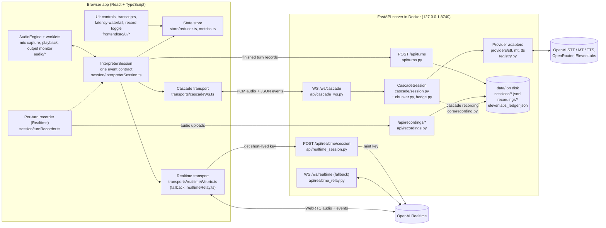
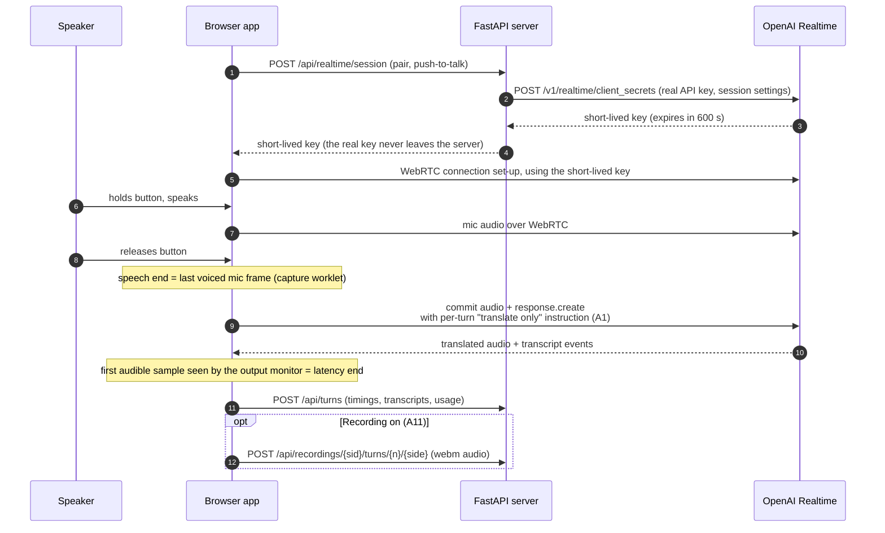
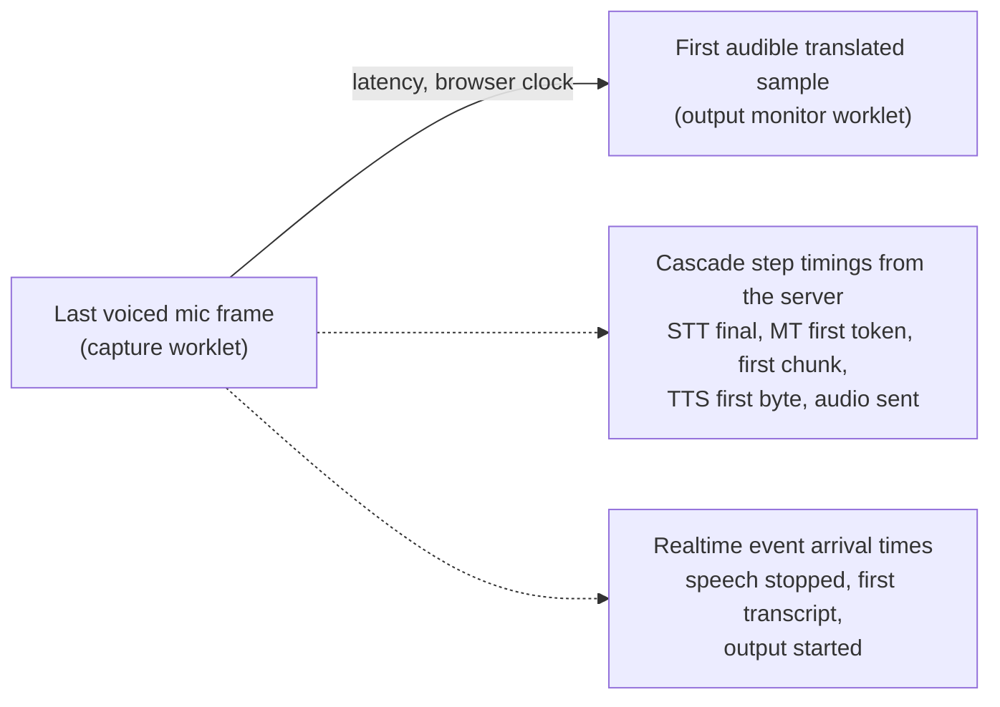

# Architecture

This is an overview of how the AI Interpreter Workbench is built, written for a reviewer. Terms are defined as they come up. The full design, with every decision and its evidence, is in [`DESIGN.md`](DESIGN.md); this page links its amendments (A1–A11) rather than repeating them.

**The two designs compared.**
- **Realtime mode:** one OpenAI model (`gpt-realtime`) listens to the speaker and speaks the translation.
- **Cascade mode:** three services in a chain:
  1. **speech-to-text (STT)** writes down the speech;
  2. a **translation model (MT, machine translation)** translates the text;
  3. **text-to-speech (TTS)** reads it aloud.

**How it is packaged.**
- One **Docker** container (a self-contained, packaged app) runs a Python **FastAPI** web server.
- That server serves the browser app, built with React and TypeScript, plus a few HTTP endpoints and two **WebSocket** endpoints. A WebSocket is a connection that stays open so both sides can stream data.
- It listens only on `127.0.0.1:8740`, the lab machine itself. The Mac reaches it through an SSH port-forward (`docker-compose.yml`, DESIGN D7).

## 1. System overview



## 2. Components and layers

| Layer | What it does | Where (verified paths) |
|---|---|---|
| **UI** | Mode toggle, push-to-talk buttons for Speaker A/B, live transcripts, latency waterfall and summary, error banners, provider selectors, "Record session" toggle; a **Review** tab for human quality ratings (A12) | `frontend/src/App.tsx`, `frontend/src/review/` (`ReviewTab.tsx`, `RateView.tsx`, `ResultsView.tsx`, `rateLogic.ts`, `api.ts`), `frontend/src/ui/Controls.tsx`, `TranscriptPane.tsx`, `LatencyWaterfall.tsx`, `MetricsSummary.tsx`, `ErrorBanner.tsx` |
| **State** | Turns UI state into a pure function of session events; computes rolling p50/p90 and exports JSON/CSV | `frontend/src/store/reducer.ts`, `metrics.ts`, `turnSink.ts` (posts each finished turn to the server) |
| **Session (mode-agnostic)** | `InterpreterSession` exposes one API (start, stop, setMode, pttDown/pttUp, …) and emits one set of events for both modes, so the UI never knows which mode is running | `frontend/src/session/InterpreterSession.ts`, `protocol.ts` (the **event contract**: the agreed list of event types and fields), `turnController.ts` (push-to-talk turn logic) |
| **Mode-specific transports** | **Cascade:** a WebSocket to our server carrying audio and JSON events. **Realtime:** WebRTC straight to OpenAI. WebRTC is the browser's built-in standard for live audio between two endpoints. A WebSocket relay through our server is the fallback | `session/transports/cascadeWs.ts`, `realtimeWebrtc.ts`, `realtimeRelay.ts`; OpenAI event translation in `session/normalizers/oaiEvents.ts`; Realtime instructions in `session/realtimePrompt.ts` |
| **Audio** | One audio context for both modes. Mic capture with voice detection; cascade playback; an **output monitor** (a small audio processor that notices the first audible sample of the translation) | `frontend/src/audio/engine.ts`, `capture.worklet.ts`, `playback.worklet.ts`, `outputTap.worklet.ts`, `clock.ts`; `fileSource.ts` plays test audio as the mic for benchmarks |
| **Server API** | Short-lived key minting, the cascade gateway, the Realtime relay, the turn log, recordings, review sets and ratings, health | `backend/app/main.py`, `backend/app/api/*.py` (`review.py` for `/api/review`) |
| **Review (A12)** | Review sets, items and per-rater ratings in SQLite; blind-set import and preload; recorded-session import; results aggregation | `backend/app/review/store.py`, `sources.py`, `results.py` |
| **Cascade orchestration** | Runs each turn as concurrent stages (STT → MT → sentence chunker → TTS) joined by queues. Handles cancellation, timing marks, the backup request for slow first output, early translation of partial transcripts, and merging of short fragments | `backend/app/cascade/session.py`, `ws_pipeline.py` (builds providers from config), `chunker.py`, `hedge.py` |
| **Provider interfaces** | Three abstract interfaces, so the orchestrator never imports a vendor: `STTProvider`, `Translator`, `TTSProvider`. Adapters implement them; a registry maps config names to adapters | `backend/app/providers/base.py`, `registry.py`, `stt/openai_live.py`, `mt/openai.py`, `mt/openrouter.py`, `mt/anthropic.py`, `tts/openai.py`, `tts/elevenlabs.py`, `fakes.py` (for tests) |
| **Shared core** | Server-side event models (mirroring the browser contract), normalised errors, the retry policy, the ElevenLabs credit guard, settings, audio helpers, recording store | `backend/app/core/events.py`, `errors.py`, `retry.py`, `budget.py`, `config.py`, `audio.py`, `recording.py` |
| **Experiments (A13)** | Experiment config + estimate, background job that runs `eval.harness` per setup and summarises with `eval.metrics`, SQLite store, M5 baseline import | `backend/app/experiments/config.py`, `runner.py`, `store.py`, `baseline.py`; `backend/app/api/experiments.py`; `frontend/src/experiments/` |
| **Persistence** | Files under `data/` (gitignored): one JSONL log per session (one JSON record per line), recordings, the ElevenLabs credit ledger, and the Review tab's SQLite file | `data/sessions/<session_id>.jsonl`, `data/recordings/<session_id>/turn-<n>-{source,target}.<ext>`, `data/elevenlabs_ledger.json`, `data/review.sqlite3`, `data/experiments.sqlite3` + `data/experiments/<id>/<setup>.{jsonl,log}` |
| **Evaluation harness** | Drives the real app in hidden Chrome (Playwright), plays test sentences as the mic, then computes metrics, the blind-rating kit and the error-state checks | `backend/eval/harness.py`, `metrics.py`, `blind.py`, `blind_results.py`, `error_pass.py`, plus tuning tools (`summarize.py`, `vad_table.py`, `soak_report.py`, `stt_wer.py`, `tts_ttfb.py`) |

**The shared event contract is tested on both sides.**
- The JSON samples in `contract/fixtures/` (`client_messages.json`, `server_events.json`) are checked by the TypeScript types and by the Python models in `core/events.py`.
- So the browser and server can't silently drift apart.

## 3. Realtime mode, step by step



- After each reply, the browser deletes older conversation items, keeping the last one or two turns. This limits re-billing and drift (DESIGN §2 "Prune history").
- If WebRTC can't connect, `realtimeRelay.ts` streams through `WS /ws/realtime` on our server instead. It uses the same event contract.

## 4. Cascade mode, step by step

```mermaid
sequenceDiagram
  autonumber
  participant U as Speaker
  participant B as Browser app
  participant S as FastAPI (CascadeSession)
  participant T as Speech-to-text
  participant M as Translator
  participant V as Text-to-speech
  B->>S: open WS /ws/cascade, session.start (pair, providers, record?)
  U->>B: holds button, speaks
  B->>S: 20 ms audio frames (PCM16, 24 kHz)
  S->>T: stream audio
  T-->>S: running draft transcript (partials)
  S-->>B: transcript.partial (shown live)
  Note over B,S: a pause of 300 ms or more commits a segment;<br/>short unpunctuated fragments are merged into the next one (A8)
  S->>M: translate the draft early, held until the final matches (A4)
  U->>B: releases button
  B->>S: commit
  T-->>S: final transcript
  M-->>S: translation, streamed word by word
  S->>V: first sentence chunk (backup request if nothing after 1.5 s, A7)
  V-->>S: audio
  S-->>B: translated audio frames + latency marks per step
  Note over B: first audible sample = latency end
  S-->>B: turn.done (usage, timings, recording paths)
  B->>S: POST /api/turns
```

- **PCM16, 24 kHz** is raw, uncompressed audio: 16-bit samples, 24,000 per second.
- Every chosen provider supports this format natively, so no conversion happens except at mic capture (DESIGN §2).

## 5. Data flow and storage

- **Audio.**
  - **Realtime:** browser ↔ OpenAI directly; our server never sees the audio (except via the relay fallback).
  - **Cascade:** browser → our server → each vendor in turn → our server → browser.
- **Text and timings.** Every finished turn is posted to `/api/turns` and appended to `data/sessions/<session_id>.jsonl`. A record holds the mode, languages, status, latency, per-step timings, transcript, translation and usage. The test harness reads the same files.
- **Recordings (A11, off by default).**
  - **Cascade:** captured on the server and written as WAV when the turn ends.
  - **Realtime:** captured in the browser as webm/opus and uploaded.
  - Each saved file adds an audit line to the session JSONL. A sweep at startup and every 6 h deletes files older than `retention_days` (30).
- **The session id** is created in the browser (`session/sessionId.ts`) and validated by the server.
- **The only databases** are two SQLite files: the Review tab's (`data/review.sqlite3`, A12), where ratings are edited in place and need atomic updates, and the Experiments tab's (`data/experiments.sqlite3`, A13). Everything else stays in plain files.

### 5a. Review tab flow (A12)

1. **Startup:** `get_review_store()` opens `data/review.sqlite3`. It imports the blind set from `BENCH_DIR/blind` (`rating_sheet.csv` + `key.csv`; the key's profile is kept as a hidden `variant`) and preloads Andre's sheet as rater `andre` if that rater has no ratings yet. Both steps are idempotent.
2. **Pick a rater:** the browser keeps the name in `localStorage`. `GET /api/review/sets?rater=` lists sets with that rater's progress. `GET /api/review/sessions` lists recorded sessions; `POST /api/review/sessions/<sid>` turns one into a set (each turn's target audio plus its transcripts).
3. **Rate:** `GET /api/review/sets/<id>?rater=` returns the items (without a variant while blind) and this rater's ratings. The view opens at the first incomplete item. Audio streams from `/api/review/sets/<id>/items/<item>/audio`. Each Save is a `PUT …/items/<item>/rating`, one SQLite transaction.
4. **Results:** `GET …/results?rater=&raters=me|all` aggregates per variant × direction and adds M5 H and chrF from `results.json`. For blind sets it returns 403 until the rater presses Reveal (`POST …/reveal`) or completes the set. `results.csv` and `ratings.csv` export the same data.
5. **Cleanup:** `DELETE …/ratings?rater=` removes one rater's ratings and their reveal.

### 5b. Experiments tab flow (A13)

1. **Startup:** `get_experiments()` opens `data/experiments.sqlite3`, marks runs left `running` as `interrupted`, and imports `results/m5/results.json` (+ `raw/`) once as the read-only `m5-baseline`.
2. **Configure:** the tab loads `GET /api/experiments/setups` (setups, warnings, availability, threshold, the 48 utterances). Every change calls `POST /api/experiments/estimate`, which validates the config (422 with a message) and returns cost and duration per setup.
3. **Run:** `POST /api/experiments`. The server refuses unavailable setups (400), estimates above the threshold without `confirm` (428) and a second concurrent run (409). It then creates the row and starts the job.
4. **Job:** for each setup, `python -m eval.harness --url http://127.0.0.1:8740 <setup flags> --ids … --repeat <passes> --out data/experiments/<id>/<setup>.jsonl --chrome ''` runs in its own process session. Headless Chromium opens the SPA with `?source=file`, plays each fixture as the microphone and measures H, exactly like M5. The job polls the JSONL (0.3 s), stores each row with its `row_cost`, and publishes progress to the SSE subscribers (`GET /api/experiments/<id>/events`).
5. **Finish / cancel:** after the last setup, or after `POST …/cancel` (which kills the process tree), it runs `eval.metrics.per_row` + `aggregate` per setup in a thread and stores the summary, cost, models, status and elapsed time.
6. **Read:** `GET /api/experiments`, `/<id>`, `/<id>/turns`, `/<id>/export.json`, `/<id>/export.csv?kind=summary|turns`. Compare is client-side, from two details.

## 6. Where latency is measured



- **The headline number is measured only in the browser,** on one clock, the same way in both modes (DESIGN §4).
- **Step timings** come from the server for the cascade and from OpenAI event arrival times for Realtime. They are shown as a waterfall chart, but they are never subtracted from browser times, because they come from different clocks.
- **The test harness** releases push-to-talk 0.45 s after the last word and reports results with and without that gap (A2, A5).

## 7. Error handling

DESIGN §6 has the full table. In short:
- **Retries happen only before a step's first output:** at most 2, with growing random waits starting at 200 ms, honouring the provider's `Retry-After` header (`core/retry.py`). Once audio has started, a failure ends that turn instead, so audio is never repeated.
- **Watchdogs** (time limits): 3 s each for the STT final, the MT first token and the TTS first byte; 20 s per turn; 5 s to connect (`config/app.yaml` `timeouts_s`).
- **Backup request:** if MT or TTS is silent for 1.5 s, one backup request races the original (`cascade/hedge.py`, A7).
- **Normalised errors** from every adapter: rate limited (HTTP 429), timeout, auth error, config error, provider disconnected, empty result, budget exceeded (`core/errors.py`). Each reaches the UI as a labelled banner, the failed turn is marked, and the session continues.
- **Browser cases:** mic denied (with a Retry button), insecure page, ElevenLabs disabled and silent turns all show clear messages. These were checked by `eval/error_pass.py`; results are in [`benchmarks/results/m5/error_pass.txt`](benchmarks/results/m5/error_pass.txt).

## 8. Configuration

- **`config/app.yaml`:** active providers and model ids. Model ids live only here, not in code. It also holds cascade switches (early translation, fragment merging, chunk sizes), timeouts, ElevenLabs caps and recording settings.
- **Environment variables** override it: `CASCADE_STT`, `CASCADE_MT`, `CASCADE_TTS`, `REALTIME_MODEL`, `MT_MODEL`, `RECORDING_ENABLED`, `ELEVENLABS_ENABLED` and others.
- **`config/languages.yaml`:** language pairs and an optional glossary per pair.
- **`config/pricing.yaml`:** dated prices, used only by the evaluation metrics.
- **`GET /healthz`** reports which providers are ready, the active models, the swap options and the recording state.

## 9. Security posture

**What is in place.**
- **API keys stay on the server.**
  - The OpenAI and OpenRouter keys are read from a `.env` file (mode 600, gitignored), which `scripts/setup_env.py` writes from key files on the lab machine. The direct Anthropic key is no longer loaded (A3).
  - The ElevenLabs key is mounted as a Docker secret file and never put in `.env`.
- **Short-lived keys for the browser.** For Realtime, the server mints a key valid for 600 s (`realtime.secret_ttl_s`); the real OpenAI key never reaches the browser. Only `gpt-realtime` and `gpt-realtime-mini` can be requested.
- **Local only.** The app is bound to `127.0.0.1` and reached through SSH. Browsers allow the mic and WebRTC on `http://localhost`.
- **Input validation on recordings:** session id pattern, whitelisted turn and side, content type and a 20 MB size cap. Writes are atomic, and path traversal is blocked (A11).

**What is missing for production.**
- **No user authentication or authorisation on any endpoint.** Anyone who can reach the port can mint Realtime keys (spending our OpenAI budget), open cascade sessions, post turn records, and upload or delete recordings.
- **No encryption at rest** for logs or recordings, and no access logging.
- **No per-participant consent record** beyond the UI notice.
- **No rate limiting** on our own endpoints.

[SCALING.md](SCALING.md) lists what production would need.

## 10. Key design decisions and tradeoffs

| Decision | Why | Tradeoff | Where |
|---|---|---|---|
| Realtime over WebRTC directly to OpenAI, with a server-minted short-lived key | OpenAI recommends WebRTC for browsers; built-in jitter handling and echo cancellation; no relay handicap in the comparison | Audio bypasses our server, so server-side logging or recording needs the browser to upload | DESIGN D1, §1 |
| One mode-agnostic session API and event contract | The UI and the metrics are identical for both modes; switching modes mid-session is clean | A normaliser must map OpenAI's events onto the contract | DESIGN §1 |
| Latency measured only in the browser | It is what the listener experiences; one clock for both modes | Server step timings are diagnostics only | DESIGN §4 |
| Push-to-talk as the default | Direction is known, so a per-turn "translate only" instruction is possible; fewer split turns | One button press per turn; hands-free mode is available but weaker on monologues | DESIGN D2, A1, A2 |
| Cascade translates the draft transcript early | About 0.5 s faster on the last part of a turn | Extra calls when the draft changes | A4 |
| Backup request for slow first output | Removed time-outs in tests (3 of 96 before, 0 of 192 after) | One extra request in a few percent of steps | A7 |
| Merge short fragments | Better translations (chrF +3.1 / +1.8) | About +0.2 s on short sentences | A8 |
| No early translation with ElevenLabs | Discarded drafts would spend free credits | Gives up the A4 speed gain on that voice | A9 |
| Provider defaults: nano for speed, Haiku as the quality option | Latency target vs. translation score | Two options to explain | A10 |
| Opt-in per-turn recording, off by default, 30-day retention | Auditability without recording by default; per-turn files line up with turn records | Local files only; needs encryption and auth before real use | A11 |
| Python/FastAPI instead of the brief's preferred .NET | Andre's choice: the streaming-audio SDKs and evaluation tools are Python-first (README "Why Python rather than .NET") | Not Boostlingo's main stack | DESIGN header, README |
| Plain files instead of a database | Simple, inspectable, enough for one user | Doesn't scale or support multiple servers (see [SCALING.md](SCALING.md)) | DESIGN §4, A11 |
