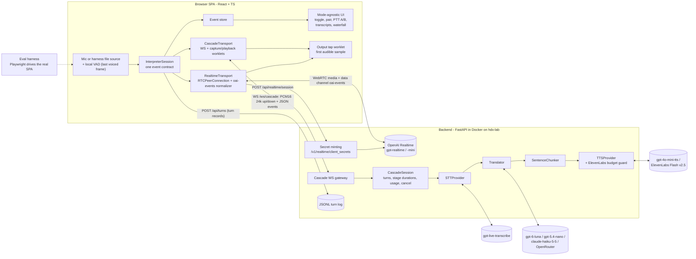

# DESIGN: AI Interpreter Workbench

| | |
|---|---|
| **Status** | v0.2 approved 2026-10-08; amended after M2 by Andre's decisions (see [Amendments](#amendments-after-approval)) |
| **Inputs** | [`PRD.md`](PRD.md) v0.1, [`sources/assignment.pdf`](../sources/assignment.pdf) (authoritative), [`api-research.md`](api-research.md) (cited as "R§x") |
| **Fixed by Andre** | Python (FastAPI) backend, TypeScript (React + Vite) frontend, Docker on hdx-lab, one setup command, local-only. Providers: OpenAI, Anthropic, ElevenLabs (free tier), OpenRouter, local/free |
| **Targets** (PRD §3, NFR-1/2, from the brief) | Realtime **< 1.5 s**, Cascade **< 3 s, target < 2 s**, speech end → first audio out; 5-minute conversation with no disconnect, drift or leak |

**Summary.**
- **Realtime mode:** the browser talks to OpenAI directly over **WebRTC** (`gpt-realtime`; `gpt-realtime-mini` in dev), using a short-lived secret minted by FastAPI.
- **Cascade mode:** the browser streams PCM to FastAPI over a **WebSocket**. FastAPI runs `gpt-live-transcribe` → streaming LLM (`gpt-6-luna` / `claude-haiku-5-5`) → `gpt-4o-mini-tts` (ElevenLabs Flash as the swap).
- **Shared:** both transports sit behind one client `InterpreterSession` that emits one event contract. Latency is measured identically in the browser, from the last voiced mic frame to the first audible output sample.

## Decisions for Andre

1. **D1 Realtime transport: browser↔OpenAI WebRTC with a FastAPI-minted ephemeral secret (recommended; flipped from the v0.1 draft's WS relay).** Fallback: a FastAPI WebSocket relay to OpenAI behind the same client contract. This matches PRD FR-2, FR-2.1 and CQ-1 as written, so no amendment is needed.
2. **D2 Turn-taking default: push-to-talk with Speaker A (EN→ES) / Speaker B (ES→EN) buttons (recommended)** vs VAD (Realtime `server_vad`; Cascade local browser VAD, since `gpt-live-transcribe` has none). Both are built and both benchmarked, with matched silence windows. Approving PTT amends PRD FR-2.2 / Q5.
3. **D3 Quality metrics:** `jiwer` WER with Whisper normalizers, plus `sacrebleu` chrF (primary) and BLEU against reference translations, plus the PRD's blind 1–5 adequacy/fluency/naturalness rating. COMET (`Unbabel/wmt22-comet-da`, local CPU) optional if time allows. An LLM judge is optional, used only for the "answered instead of translated" flag.
4. **D4 Model defaults and final-numbers matrix:**
   - Cascade defaults: STT `gpt-live-transcribe`; MT `gpt-6-luna` (`reasoning.effort: "none"`) vs `gpt-5.4-nano`, chosen by measured TTFT in M1; TTS `gpt-4o-mini-tts`.
   - Measured profiles: `realtime` (`gpt-realtime`), `cascade-openai`, `cascade-haiku` (`claude-haiku-5-5` MT), `cascade-elevenlabs` (Flash TTS, subset).
   - Optional third variant `realtime-translate` (`gpt-realtime-translate`) as a stretch / write-up data point only.
   - Confirm which keys exist (OpenAI with Realtime access, Anthropic).
5. **D5 Spend:** `gpt-realtime-mini` for all dev; `gpt-realtime` only for final runs (the brief mandates it). Set an OpenAI spend cap for eval. ElevenLabs guard caps: 1,500 chars/session, 8,000/month (of 10,000 free credits).
6. **D6 Echo:** headphones for the demo and video. Half-duplex mic gating during playback is **on in both modes by default**.
7. **D7 Browser access to hdx-lab:** the mic and WebRTC need a secure context (R§5.4). Options: SSH port-forward to `http://localhost` (recommended, no certificates) vs Caddy internal TLS (needs a trusted local CA on the Mac).
8. **D8 Cascade playback policy:** `after_speech_end` (consecutive, recommended; matches Realtime's turn behaviour) vs `immediate` (simultaneous).
9. **D9 Eval data:**
   - Fixtures from OpenAI TTS voices plus ~10 human recordings per language: who records?
   - Who spot-checks the Spanish reference translations and does the blind ratings (PRD Q7)?
10. **D10 PRD/README amendments:**
    - PRD §9 / Q1 and the README layout say **ASP.NET Core**: replace with Python/FastAPI. The brief prefers .NET, so the README must justify Python (CQ-5).
    - PRD Q2 / Q3 suggest **Deepgram, DeepL** (and Azure keys), which are outside Andre's allowed providers: replace with OpenAI / Anthropic / ElevenLabs / OpenRouter.
    - FR-2.2 if D2 = PTT.



## Amendments after approval

Decided by Andre (CTO) on 2026-10-08 after the M2 smoke run. These are deliberate deviations from v0.2.

- **A1: per-turn direction instructions in Realtime PTT (on by default).**
  - What: every PTT `response.create` carries `response.instructions` = "the speaker just spoke *SRC*; say only the faithful *TGT* translation; never answer". It overrides the bidirectional session prompt for that response only (`frontend/src/session/realtimePrompt.ts`; `directionHint: false` turns it off). VAD mode keeps the session prompt, since the direction is unknown there.
  - Why: PTT already knows the direction (Speaker A/B), so there's no reason to make the model infer it. In the first M2 ES→EN run, **2 of 5 turns were answered instead of translated** with the session prompt alone ("I'm sorry you're feeling that way… seek medical attention"). With A1 on (and the A2 release policy), all 20 following PTT turns were correct translations (`docs/benchmarks/m2-realtime-smoke.md`).
  - Effect on §2 and R2: the language policy is now enforced per response in PTT. The harness still measures the "answered" rate.
- **A2: fixed 450 ms PTT release policy for every benchmark variant, and the release gap is reported alongside every number.**
  - What: the harness releases PTT 450 ms after the last voiced frame, in every mode and profile. This replaces §9's "released at end + 150 ms". Every reported H is given twice: as measured (including the release gap) and with the release gap subtracted (H − (t_release − t_speech_end), per turn).
  - Why: the ES fixture has a 350 ms in-sentence pause. A shorter release window cut the turn mid-sentence (the M1 ES cascade numbers and the first M2 ES realtime run were affected). The same fixed window for every variant keeps the comparison fair, and the subtracted number shows system latency independent of the policy.
  - Effect on §4: the H definition is unchanged; A2 only fixes how the harness, as the "user", releases.

Decided or recorded during M4 (2026-10-08):

- **A3: Haiku runs only via OpenRouter; the direct Anthropic route is dropped (Andre).**
  - What: `cascade-haiku` = MT `openrouter` with model `anthropic/claude-haiku-5.5` (`provider.sort: latency`). The direct Anthropic adapter (`providers/mt/anthropic.py`) stays in code, tested with mocks, but disabled (`providers.anthropic.enabled: false`), and `setup_env.py` no longer loads the Anthropic key or workspace id.
  - Why: the direct key returned HTTP 400 `invalid_request_error` ("Your credit balance is too low to access the Anthropic API…"), a billing state, not a code issue. Andre approved OpenRouter instead; its one validity check through the adapter returned 200.
  - Use: benchmarks and the demo only, never tests or loops (tests mock it).
- **A4: speculative MT in the cascade (on by default).**
  - What: STT partials stream while the user speaks, so at each commit the segment's partial is usually complete. MT → chunker → TTS start on it immediately; the run is held (no audio, no translation events, no marks) until the STT final arrives, then adopted if the final matches case/punctuation-insensitively, else cancelled and redone on the final. STT `delay` stays `low` (`minimal` is ~0.2 s faster but raised WER 2–3×); the first TTS chunk is cut at a word boundary once 20 chars are buffered (`chunker.first_word_min`).
  - Why: measured in M4 (`docs/benchmarks/m4-tuning.md`): the last-segment latency fell by ~0.5 s (tail p50 2.08 → 1.58 s with STT delay low). 0 mismatches in 242 adoptions across the tuning runs. Cost: extra MT/TTS calls when a later partial changes the text.
  - A `pause.hint` message (speculate at 150 ms of silence, before the pause commit) was built and measured with no gain; it ships off (`?hint_ms=`).
- **A5: harness release rule and file source details (refines A2 and §9).**
  - What: the harness releases PTT 450 ms after the utterance's **last** voiced frame (it knows the fixture; the offset is precomputed with the capture VAD rule), not at the first 450 ms pause. The file source adds a -60 dBFS noise floor.
  - Why: the TTS fixtures have 0.5–0.9 s pauses between sentences, which would end turns early under a first-pause rule; a person holding PTT releases when they are done. With pure digital silence between files the WebRTC sender went quiet and the Realtime server VAD never saw speech end.
- **A6: cascade VAD mode implemented in the browser.**
  - What: `VadSegmenter` (3-frame debounce, 300 ms pre-roll, end after `silence_duration_ms`, the same window value as Realtime `server_vad`); the user picks the speaker (direction) in the UI, because STT/MT need it.
- **A7: hedged first output for cascade MT and TTS (M5, Andre).**
  - What: if an MT or TTS request has produced nothing after `timeouts_s.hedge_s` (1.5 s), one backup request with the same input starts; the first to yield output wins and the other is cancelled. The 3 s first-output deadline still applies. Only the first item is raced, so audio is never duplicated (the §6 rule). Hedges are logged and reported as `*_hedge_fired` / `*_hedge_won` server marks.
  - Why: M4 had 3/96 first-output timeouts (2 MT, 1 TTS) from rare slow provider requests. In M5 there were 0/192 timeouts; 7 hedges fired and 3 were won by the backup. The cost is one extra request in about 3–4% of segments.
- **A8: fragment segments are merged server-side (M5).**
  - What: a non-final in-turn segment that is short (< 6 words) and has no sentence-final punctuation ("Do you have") is not translated alone; it is prepended to the next segment (speculation included). The last segment is never held. Toggle with `cascade.merge_fragments` / `CASCADE_MERGE_FRAGMENTS`.
  - Why: 300 ms pause commits produced fragment translations ("¿Tienes? / ¿Alguna alergia?"). In the A/B (2×48 each), merging raised chrF from 69.8 to 72.9 (EN→ES) and from 76.6 to 78.4 (ES→EN). The cost is about 0.2 s on short turns (H p50 1571 → 1791 ms); medium and long turns are unchanged.
  - Rejected alternative: gating pause commits in the browser on ≥ 1 s of speech. It pushed short-turn H to about 2.1–2.4 s, because the early pause commit is what lets speculative MT start before the PTT release. It is still available as `?min_seg_ms=` for A/B runs and is off by default.
- **A9: no speculative MT/TTS with ElevenLabs by default (M5, Andre).**
  - What: when the TTS is ElevenLabs, speculation is off unless `cascade.speculative_with_elevenlabs: true`. Other TTS providers keep it on.
  - Why: chunks from cancelled speculative runs still count against the free-tier budget. In M5 the guard's ledger charged 883 chars for a subset that ElevenLabs billed at 403–445. Turning speculation off saves demo credits; the cost is the M4 speculation gain on those turns.
- **A10: provider defaults after M5 (Andre).**
  - `gpt-5.4-nano` stays the cascade MT default because of the latency target (H p50 545 ms vs 1654 ms for Haiku).
  - Haiku via OpenRouter is the quality option (chrF about 81/84 vs 73/78).
  - Fragment merging (A8) stays on.

## 1. Transport per mode

**Weighing it.** In the v0.1 draft, the relay's two main arguments were one server clock and a mode-agnostic UI. The first no longer holds: the headline is measured in the browser in both modes (NFR-5, R§1.7), so server timestamps are diagnostics either way. The second can be had with a client-side adapter. Meanwhile the research gives concrete evidence for WebRTC:
- OpenAI recommends WebRTC over WebSockets for browser clients "for more consistent performance" (R§1.2).
- The server automatically truncates unplayed audio on interruption (R§1.2).
- The codec is negotiated with a native jitter buffer, and there is no manual 24 kHz resampling or PCM playback (R§1.5).
- Browser AEC targets exactly this kind of `RTCPeerConnection` playout (R§5.4).

A relay would also give Realtime a handicap that reviewers would discount, when the point of the comparison is each architecture at its best. **So Realtime uses WebRTC direct (D1).** Cascade uses a WebSocket to FastAPI, because its pipeline lives server-side. The relay remains the documented fallback, e.g. if WebRTC fails on the network or in headless Chrome.

| | Realtime: WebRTC (recommended) | Cascade: WebSocket |
|---|---|---|
| Setup | `POST /api/realtime/session` → FastAPI calls `POST /v1/realtime/client_secrets` (`expires_after` 10–7200 s, default 600) with `session.type: "realtime"`. The browser POSTs its SDP to `/v1/realtime/calls` with `Bearer ek_…` (R§1.2–1.3). The key never reaches the browser (FR-2.1, NFR-4). Mint per connect and per mode switch | `wss://…/ws/cascade`, same origin as the SPA |
| Audio | Mic track via `addTrack`; translated audio on the remote track; omit `audio.format` (R§1.5) | Up: PCM16 mono 24 kHz, 20 ms binary frames. Down: binary frames (4-byte `turn_id` header + PCM16 24 kHz) |
| Events | Data channel `oai-events` (GA names, R§1.6). A client normalizer maps them to the contract below | Backend emits the contract directly |
| Limits | Session max 60 min (R§1.3); 5-min soak fits | — |

**Mode-agnostic UI (CQ-1).** The UI depends only on `InterpreterSession` (`start/stop/setMode/setPair/pttDown/pttUp`) and its normalized events. Both transports implement it. A mode switch (FR-4) calls `transport.close()`, which stops tracks, closes the peer connection or WS, and disconnects audio nodes. The new transport then starts, and the store inserts a switch marker while keeping the history.

**Event contract** (TS in `frontend/src/session/protocol.ts`; the cascade side mirrors it as pydantic models in `backend/app/core/events.py`; shared JSON fixtures are tested on both sides):

| Event | Fields | Realtime source (R§1.6) |
|---|---|---|
| `turn.started` / `speech.ended` | `turn_id`, `src`, `tgt`; `t_speech_end` (browser) | local VAD / PTT; `input_audio_buffer.speech_started/stopped` logged |
| `transcript.partial` / `.final` | `turn_id`, `seg`, `text` (FR-6) | `conversation.item.input_audio_transcription.delta` / `.completed` (keyed on `item_id`) |
| `translation.partial` / `.final` | `turn_id`, `seg`, `text` | `response.output_audio_transcript.delta` / `.done` (concatenate deltas as-is, R§5.4) |
| `audio.started` / `audio.ended` | `turn_id`, `t_first_audible` | output tap; `output_audio_buffer.started/stopped` logged |
| `latency.mark` | `turn_id`, `mark`, `ms` from speech end (§4) | event arrival times |
| `turn.done` / `turn.skipped` | marks, usage, reason | `response.done` (usage, status) |
| `error` | `code`, `stage`, `retryable`, `message` | `error`, `…transcription.failed`, `rate_limits.updated` |

Cascade control messages (C→S): `session.start` / `session.update` (`src`, `tgt`, `turn_mode`, providers), `commit` (PTT release or VAD pause), `turn.cancel`, `ping`.

## 2. Provider interfaces (CQ-2)

```python
class STTProvider(Protocol):   # audio items: PCM16 24 kHz bytes, or Commit() at PTT release / VAD pause
    def stream(self, audio: AsyncIterator[bytes | Commit], langs: list[str]) -> AsyncIterator[TranscriptEvent]: ...
class Translator(Protocol):    # yields text tokens
    def stream(self, text: str, src: str, tgt: str, ctx: TurnContext) -> AsyncIterator[str]: ...
class TTSProvider(Protocol):   # sentence chunks in, PCM16 24 kHz out, in order
    def stream(self, chunks: AsyncIterator[str], lang: str, voice: str) -> AsyncIterator[bytes]: ...
```

- **Registry.** `@register("tts", "elevenlabs")` maps names to factories. The active set comes from `config/app.yaml`, overridable by env (`CASCADE_STT`, `CASCADE_MT`, `CASCADE_TTS`, `REALTIME_MODEL`). The orchestrator imports only the Protocols. **A swap = one adapter file + one config value + its contract test.** OpenRouter is the OpenAI chat adapter with another `base_url` (optional `provider.sort: "latency"`, R§3.1).
- **Adapters normalize** audio to PCM16 mono 24 kHz, which all chosen providers support natively (R§5.4), so no resampling occurs except mic capture in the worklet. They also normalize errors (`RateLimited(retry_after)`, `ProviderTimeout`, `AuthError`, `ConfigError`, `ProviderDisconnected`, `EmptyResult`, `BudgetExceeded`) and report `Usage` (audio s, tokens, chars).

| Adapter | Facts the adapter encodes (research section) |
|---|---|
| `stt/openai_live.py` | Realtime **transcription** session over WS: `session.type: "transcription"`, `audio/pcm` 24000, model `gpt-live-transcribe`, `turn_detection: null`, `languages: ["en","es"]`, `delay: "low"` (try `"minimal"`); `input_audio_buffer.append` then `commit` per segment; partials from `…input_audio_transcription.delta` (revisable), finals from `.completed` (R§2.2). *Uncertain:* exact WS URL for transcription sessions; take it from the `openai` SDK |
| `mt/openai.py` | `gpt-6-luna` with `reasoning.effort: "none"` (default is `medium`), or `gpt-5.4-nano` (default `none`); streamed; static system prompt first for caching; small max output tokens (R§3.1, §3.2) |
| `mt/anthropic.py` | `claude-haiku-5-5`, `thinking: {type: "disabled"}`, **no `temperature`/`top_p`/`top_k`** (400 error) (R§3.1) |
| `tts/openai.py` | `POST /v1/audio/speech`, `gpt-4o-mini-tts`, `response_format: "pcm"` (raw 24 kHz s16le), `stream_format: "audio"`. Whole text per request, so one request per chunk with one-chunk lookahead (R§4.1) |
| `tts/elevenlabs.py` | `eleven_flash_v2_5` over `wss://api.elevenlabs.io/v1/text-to-speech/{voice}/stream-input`, `output_format=pcm_24000`, `language_code`, `auto_mode=true`, `flush: true` at segment end, `" "` keep-alive (idle close at 20 s; `""` closes the socket) (R§4.2) |

Model ids live only in config. Most current ids are deprecated with Jan–Apr 2027 shutdowns (`gpt-realtime`/`-mini` Jan 20, `gpt-4o-mini-tts` Jan 6, `gpt-5.4-nano` Apr 1; R "Deprecation watch"). That's fine for Oct 11 and worth a vendor-lock-in line in the write-up.

**ElevenLabs is scarce (free tier, 10,000 credits/month).**
- The key stays on hdx-lab at `~/.config/agentforge/elevenlabs_api_key`, mounted as a compose secret and read via `ELEVENLABS_API_KEY_FILE`. It never goes in `.env`, logs or the repo.
- OpenAI TTS is the default for dev, tests and the baseline; ElevenLabs is used only for its benchmark profile and the demo.
- `ElevenLabsBudget` wraps the adapter. It refuses unless `ELEVENLABS_ENABLED=1` and enforces `ELEVENLABS_SESSION_CHAR_CAP=1500` and `ELEVENLABS_MONTH_CHAR_CAP=8000` via a persistent ledger `data/elevenlabs_ledger.json`. It counts conservatively at 1 credit/char.
- Over the cap it raises `BudgetExceeded` *before* the API call, and the UI says "switch TTS to OpenAI". There is no silent fallback, which would contaminate measurements. Concurrency is 1 socket per session; free-plan concurrency is unverified (R§5.3).

**Realtime session config** (`backend/app/realtime/session_config.py`, R§1.4):
- `output_modalities: ["audio"]`; voice `marin`, the same for both directions, since the voice can't change after the first audio.
- `audio.input.noise_reduction` set to `near_field` for headsets or `far_field` for laptop mics.
- `transcription.model: "gpt-4o-transcribe"`. It is the one model every source lists as supported in `realtime` sessions; `gpt-live-transcribe` there is *uncertain* (R§1.6).
- Turn detection: `server_vad` (`silence_duration_ms` 300/400/500 sweep, `create_response: true`, `interrupt_response: false`) in VAD mode, or `null` in PTT mode.
- **Interpreter instructions** with an explicit language policy (EN in → ES only; ES in → EN only; never answer, greet or comment; preserve names and numbers; stay silent on unintelligible audio).
- **Prune history:** after each `response.done`, `conversation.item.delete` all but the last 1–2 turns. This bounds cost and reduces "answering" drift.
- `REALTIME_MODEL` takes `gpt-realtime` | `gpt-realtime-mini`. The optional **`realtime-translate`** variant uses a separate endpoint (`/v1/realtime/translations/client_secrets` and `/calls`): no `response.create`, continuous output, one session per direction (R§1.8).

## 3. Cascade streaming strategy (FR-3)

Each turn is an `asyncio.TaskGroup` of stages joined by bounded queues (FR-3.4); cancelling the group handles barge-in, mode switch and disconnect.
- **STT:** frames are appended as captured. Partials go to the UI only (FR-6). A **commit** is sent at PTT release *and* at in-turn pauses ≥ 300 ms detected by the browser VAD, so long turns yield several segment-level finals (FR-3.1/3.2, no full-utterance blocking).
- **Translate on finals by default.** Partials are revisable (R§2.2) and audio can't be retracted. Eager stable-prefix translation is a stretch (EN↔ES reordering makes early chunks risky, R§3.2).
- **Translator:** streaming, "Translate from {src} to {tgt}. Output only the translation". Context is the last 2 turns plus the pair's optional glossary (controllability, DEL-2).
- **Sentence chunker** (pure function, unit-tested):
  - emits at a sentence terminator (`. ? ! …`, ≥ 12 chars), at a clause boundary (`, ; :`) once ≥ 60 chars are buffered (**25 for the first chunk**), at a 160-char cap, or at end of stream;
  - protects decimals, times and abbreviations (`Dr.`, `Sra.`, `p. ej.`).
  
  Each chunk goes straight to TTS, and audio is emitted in order, so first audio waits only for the first chunk.
- **Playback** (`after_speech_end`, D8): a turn's audio starts after that turn's speech end. The write-up also reports **tail latency** (speech end → TTS first byte of the last segment), so pre-buffered early segments can't flatter the headline.

## 4. Latency instrumentation (FR-7, NFR-1, NFR-5)

**Headline H = `t_first_audible − t_speech_end`, both `performance.now()` in the browser, identical in both modes** (R§1.7, §6.3):
- `t_speech_end` = the last voiced frame from the capture-worklet energy VAD (the same detector in both modes, in PTT and VAD). A late PTT release or a VAD silence window therefore counts against H, as the user perceives it.
- `t_first_audible` = the first output sample above threshold, seen by an **output-tap AudioWorklet**: on the remote WebRTC track for Realtime, and on the playback graph for Cascade. Worklet render-quantum timestamps (128 samples) are mapped to `performance.now()`, plus `AudioContext.outputLatency` where reported.
- `input_audio_buffer.speech_stopped` is **not** used as speech end: its `audio_end_ms` includes the silence window, so it understates latency (R§1.7). It is logged as a diagnostic, and both numbers are reported.

**Stage marks** (ms after `t_speech_end`; diagnostics for the waterfall):

| Cascade (server durations from FastAPI's monotonic clock, sent as `latency.mark`) | Realtime (data-channel event arrival, browser clock) |
|---|---|
| `commit_sent` → `stt_final` (`.completed`) | `speech_stopped` |
| `mt_first_token`, `mt_first_chunk_ready` | `input_transcript_first` (may arrive after the translation starts, R§1.6) |
| `tts_request` → `tts_first_byte` | `output_transcript_first` |
| `audio_first_sent` | `output_audio_buffer.started` |
| browser: `t_first_audible` | browser: `t_first_audible` |

Server durations are never subtracted from browser times (NFR-5). The cascade's "network + playout" bar is H − (server's `audio_first_sent` offset), labelled as an estimate. The store keeps the rolling median and p90 of H and of each stage (FR-7) and exports JSON/CSV. Every finished turn record (marks, usage from `response.done` or the cascade usage, config) is POSTed to `/api/turns` and appended to `data/sessions/<id>.jsonl` (gitignored; FR-10). The harness reads the same log.

**Budget** (allocations to verify; R§1.4, §2.2, §4.2):

| Stage | Cascade (target 2.0 s) | Realtime (limit 1.5 s) |
|---|---|---|
| End of speech → commit | PTT ~150 ms tail / VAD 300–500 ms | VAD `silence_duration_ms` 300–500 |
| STT final after commit | ≤ 300 ms (no published ms; `delay` tunable) | — |
| MT first chunk | ≤ 600 ms (no published TTFT; measure) | — |
| TTS / model first audio | ≤ 400 ms (Flash WS TTFB 100–150 ms published; OpenAI TTS unpublished) | ≤ 800 ms model |
| Network + playout | ≤ 150 ms | ≤ 150 ms |
| **Total** | **≈ 1.6–1.9 s** | **≈ 1.3–1.5 s** |

## 5. Turn-taking and echo

| | **PTT (default, D2)** | VAD (option) |
|---|---|---|
| Direction | Speaker A/B button sets src/tgt per turn (FR-5); no language ID needed | Source selector + swap (PRD FR-5 default). The Realtime prompt is bidirectional anyway |
| Realtime | `turn_detection: null`. Press → `input_audio_buffer.clear` + enable track; release → `input_audio_buffer.commit` + `response.create` (R§1.4; verify over WebRTC in M2) | `server_vad`, `create_response: true`, `interrupt_response: false` |
| Cascade | Release → `commit`; in-turn pauses also commit (§3) | Browser VAD commits on silence ≥ the same `silence_duration_ms` (matched for fairness); `gpt-live-transcribe` has no VAD (R§2.1) |

**Echo.**
- `getUserMedia` with `echoCancellation`, `noiseSuppression` and `autoGainControl` on.
- WebRTC remote-track playout is what browser AEC targets; Web Audio playout is unverified (R§5.4).
- **Half-duplex gating in both modes, on by default:** Cascade zeroes uplink frames while its playback queue is active, plus a 300 ms tail. Realtime sets `track.enabled = false` from `output_audio_buffer.started` to `.stopped`, plus 300 ms.
- Headphones for the demo (D6).
- **Interruption (FR-1.3):** queues never overlap. A PTT press during playback flushes playback and cancels the turn (Realtime: `response.cancel` + `output_audio_buffer.clear`). Voice barge-in is out of scope.
- **Autoplay:** create or resume the `AudioContext` inside the Start click (R§5.4).

## 6. Error handling (CQ-4)

Retries apply only before a stage's first output byte: at most 2, exponential backoff from 200 ms with full jitter, honouring `Retry-After` (R§5.3). After output has started, the turn fails rather than retrying, so audio is never duplicated.

| Case | Detection → user-visible state → recovery |
|---|---|
| Mic denied / missing / ignored prompt | `NotAllowedError` / `NotFoundError` / no settle within 15 s (R§5.4) → blocking panel with the cause and fix → Retry button (FR-1.1) |
| Insecure context | `!isSecureContext` → message pointing to `localhost` / HTTPS (D7) |
| Rate limit (429) | `RateLimited`, `rate_limits.updated` → toast "provider X rate-limited" → backoff; next turn unaffected |
| Timeout | Watchdogs: STT final 3 s after commit, MT first token 3 s, TTS first byte 3 s, Realtime first audio 5 s after commit, turn 20 s, connect 5 s → stage-labelled failed turn → session continues |
| Empty result | Empty or punctuation-only final, `…transcription.failed`, an energy gate on near-silent turns, or an empty translation → `turn.skipped` → no MT/TTS |
| Provider disconnect mid-stream | `ProviderDisconnected`, data channel/peer `closed`, WS close → turn failed → reconnect for the next turn; Realtime re-mints and reconnects; transcript history kept client-side |
| Expired ephemeral token | SDP POST rejected (401 expected; exact status unverified, R§5.4) → silent re-mint once → otherwise an error banner |
| Realtime session limit | 60 min max (R§1.3) → reconnect between turns |
| Startup config / auth | pydantic-settings validation plus an auth probe per enabled provider → fail fast for defaults; optional providers shown as disabled via `/healthz` |
| ElevenLabs budget | `BudgetExceeded` before the call → "switch TTS to OpenAI"; eval aborts |

## 7. Module / layer layout

```
backend/app/
  main.py                FastAPI: serves built SPA, /healthz, /api/realtime/session, /api/turns, /ws/cascade
  api/                   realtime_session.py (mint) · cascade_ws.py (gateway) · turns.py (JSONL sink)
  core/                  events.py (contract) · config.py · errors.py · latency.py · usage.py · budget.py · audio.py
  cascade/               session.py (orchestrator, TaskGroup) · chunker.py
  realtime/              session_config.py (interpreter config; translate-variant builder)
  providers/             base.py (Protocols) · registry.py · fakes.py
                         stt/openai_live.py · mt/{openai,anthropic,openrouter}.py · tts/{openai,elevenlabs}.py
backend/eval/            run.py (Playwright driver) · wer.py · quality.py · cost.py · report.py
backend/tests/           unit/ · contract/ · live/ (opt-in)
config/                  app.yaml · languages.yaml (pairs, voices, glossary; FR-5/FR-11) · pricing.yaml (dated)
contract/fixtures/       shared event fixtures, recorded oai-events
frontend/src/
  audio/                 capture.worklet.ts (24 kHz PCM16 + energy VAD) · playback.worklet.ts · outputTap.worklet.ts · fileSource.ts
  session/               InterpreterSession.ts · protocol.ts · transports/{cascadeWs,realtimeWebrtc}.ts · normalizers/oaiEvents.ts
  store/                 reducer (transcripts, turns, metrics aggregation)
  ui/                    ModeToggle · LanguagePair · PttButtons · TranscriptPane · LatencyWaterfall · MetricsSummary · ErrorBanner
docs/benchmarks/         utterances.yaml · results/ · soak notes (DEL-4)
Dockerfile (node build → python runtime) · docker-compose.yml (app, eval profile with Playwright) · Makefile · .env.example
```

`make up` checks `.env` (copies from the example and lists missing keys), builds and starts compose, and prints the URL. Other targets: `make dev`, `make test`, `make fixtures`, `make eval PROFILE=…`, `make soak`. Add `data/` to `.gitignore`.

## 8. Test plan (CQ-3)

| Layer | Tests | PRD |
|---|---|---|
| Backend unit | Chunker (terminators, thresholds, first-chunk rule, abbreviations, flush); latency marks; event (de)serialization vs fixtures; error mapping; **budget guard** (disabled flag, session cap, month ledger, abort before call) | CQ-3.1, 3.3 |
| Orchestrator with fakes | Scripted async-iterator STT/MT/TTS with injected delays and failures: segment order, chunk→TTS pipelining, in-order audio, marks, cancellation leaves no tasks/sockets, 429 / timeout / empty paths | CQ-3.1, 3.3 |
| Provider contract | Each adapter against recorded responses, no network: event and usage mapping, PCM format, error mapping. **TTS is always mocked; no test calls ElevenLabs** | CQ-3.2 |
| Live smoke (opt-in) | One per provider, skipped without its key. ElevenLabs additionally needs `ELEVENLABS_LIVE_TEST=1`, sends ≤ 30 chars through the guard, and never runs in loops or CI | CQ-3.5 |
| Frontend (Vitest) | `oaiEvents` normalizer on recorded data-channel events; reducer partial → final; switch marker; median/p90; transport `close()` releases tracks, peer and nodes (FR-4) | CQ-3.4 |
| Manual | Mic denied → retry; both directions in both modes; mid-session switch; PTT barge-in; 5-min soak with heap snapshots (NFR-2) | FR-1…7 |

## 9. Evaluation harness (DEL-2, DEL-4)

- **Set** (`docs/benchmarks/utterances.yaml`): 24 per direction (8 short, 10 medium, 6 long multi-sentence); about half medical/legal (dosages, drug names, dates, case numbers). Fields: `id`, `lang`, `text`, `reference_translation`, `domain`.
- **Fixtures:** OpenAI TTS voices distinct from the pipeline voice, plus human recordings (D9). `*.wav` is gitignored, so the script and `make fixtures` are committed instead.
- **Driver:**
  - Playwright runs **the real SPA** in headless Chrome (`--autoplay-policy=no-user-gesture-required`) with `?source=file`. `fileSource.ts` plays each fixture into a `MediaStreamAudioDestinationNode`, whose track replaces the mic for both transports.
  - PTT is pressed at file start and released 450 ms after the last voiced frame (A2); results report H and H − release gap. The VAD variant just plays with trailing silence.
  - Both modes therefore go through their production paths, timed by the same browser instrumentation (R§1.7 "same audio into both modes").
  - Fallback if headless WebRTC misbehaves: run Realtime via the relay fallback and state it.
- **Profiles:** `realtime-mini` (dev), **`realtime`**, **`cascade-openai`**, `cascade-haiku`, `cascade-elevenlabs`, optional `realtime-translate`.
- **Metrics:**
  - H and stage p50/p90 (p95 in CSV), plus tail latency.
  - **WER:** `jiwer` with `EnglishTextNormalizer` (EN) and `BasicTextNormalizer(remove_diacritics=False)` (ES) (R§6.1). For Realtime this scores the side transcriber (`gpt-4o-transcribe`), not what the model heard; caveat it.
  - **chrF + BLEU:** `sacrebleu` vs references; COMET optional (D3).
  - "Answered instead of translated" rate; skip/failure rate.
  - **Cost/min** = Σ usage × `pricing.yaml` ÷ source-audio minutes, reported at 1 and 5 minutes of session for Realtime (history re-reads).
- **Expected cost per minute** (R§5.2 estimates on prices captured 2026-10-08; assumes ~900 chars/min and 1 min out per min in; replaced by measured usage):

| Profile | ≈ $/min | Basis |
|---|---|---|
| `realtime` (`gpt-realtime`) | **0.096** + ~0.006 input transcription + text tokens + history | audio $32 in / $64 out per 1M; 1 token per 100 ms in, per 50 ms out. A history cache miss at minute 5 ≈ $0.29/turn, hence pruning |
| `realtime-mini` | **0.030** + same extras | $10 / $20 per 1M |
| `realtime-translate` | **0.034** | per audio minute; whether streamed silence is billed is *uncertain* |
| `cascade-elevenlabs` | **≈ 0.054** | STT 0.017 + MT ≈ 0.001 + Flash $0.04/1K chars × 900 |
| `cascade-openai` | 0.018 + TTS | `gpt-4o-mini-tts` is $0.60/1M text in, $12/1M audio out, but its audio-token rate is unpublished. Use response `usage` if present in stream mode (unverified), otherwise a billing-dashboard delta over a fixed run |

- **ElevenLabs credits:**
  - A full 48-utterance run synthesizes about 4,000–4,500 target-language chars (ES runs about 15–25% longer than EN). At 1 credit/char that is about 2 runs/month. If Flash bills ~0.5 credit/char ("50% lower price per character", R§4.2; plan rules unverified, R§5.1), it is about 4 runs.
  - Therefore `cascade-elevenlabs` requires `--allow-elevenlabs`, defaults to a 24-utterance subset (≤ 2,500 chars), and pre-computes Σ len(reference_translation) × 1.25.
  - It **aborts before starting** if that estimate exceeds `--el-char-cap` (default 2,500) or the ledger's remaining allowance, and aborts live at the cap.
- **Output:** `docs/benchmarks/results/<date>-<profile>.csv` plus `summary.md`, pasted into `docs/comparison.md`. `make soak` runs a 5-min alternating script per mode and records heap (`performance.memory`), queue lag (`lastEnd − currentTime` bounded), backend RSS and disconnects (NFR-2).

## 10. Milestones (≈ 16–18 h)

| M | Scope | Exit | Est. |
|---|---|---|---|
| M0 | Compose, `make up`, FastAPI skeleton; capture worklet + VAD, playback + output tap; `InterpreterSession` + contract + fixtures; cascade WS **loopback** | Speak → hear loopback; H measured (transport + playout floor) | 2–3 h |
| M1 | Protocols, fakes, chunker, orchestrator (tests first); OpenAI STT/MT/TTS adapters; waterfall, stats, export, `/api/turns` | EN↔ES cascade; CQ-3.1/3.2 green; MT model chosen by TTFT | 4–5 h |
| M2 | Secret minting, `RealtimeTransport`, `oaiEvents` normalizer, session config, PTT + VAD, pruning, mode switch | Realtime through the same UI; switch leaks nothing | 3 h |
| M3 | Haiku MT, ElevenLabs TTS + guard, OpenRouter; record files touched per swap | Swap by config; guard tests green | 2 h |
| M4 | Fixtures, Playwright harness, soak, VAD/chunker tuning, final `gpt-realtime` runs | CSV + summary for all profiles | 3 h |
| M5 | Error-state pass, README (architecture, why Python), `AGENTS.md`, `comparison.md`, optional video | DEL-1…4 | 2 h |

**Parallelism.** M2 runs alongside M1 once the M0 contract is frozen (separate branch or agent).
- **QA:** utterance set, references, fixtures, frontend tests, error checklist, soak protocol.
- **Designer:** transcript panes, waterfall, PTT A/B, error states, working from the contract fixtures.
- **Tech Writer:** README skeleton, `AGENTS.md` log (PROC-2), `comparison.md` template mirroring `summary.md`.

Commit per logical unit (PROC-3).

## 11. Risks

- **R1 (resolved):** `gpt-live-transcribe` streams revisable partial deltas during speech, with latency tunable via `delay`, but it has **no VAD**, so we commit (PTT release, in-turn pauses, or browser VAD) (R§2.1–2.2). Residual: no published ms figures, and the transcription-session WS URL is undocumented (use the SDK).
- **R2 (mitigated, not removed):** `gpt-realtime` may answer instead of translating. Mitigations: audio-only output, an explicit language-policy prompt, history pruning, `interrupt_response: false`, and the harness measures an "answered" rate. `gpt-realtime-translate` eliminates this failure mode, but it can't be Realtime mode (the brief mandates `gpt-realtime`), its language list is unpublished, and its simultaneous output makes "speech end → first audio" non-comparable (R§1.8). Optional variant only.
- **R3:** Realtime re-bills the whole conversation per response (cache miss ≈ $0.29/turn by minute 5). Mitigation: prune items; report cost at 1 and 5 minutes.
- **R4 (new):** headless Chrome WebRTC + file source must work for the harness. Fallback: relay path for Realtime, disclosed.
- **R5:** browser AEC on Web Audio playout is unverified. Mitigation: half-duplex gating in both modes, headphones.
- **R6:** the silence window counts against latency (and `speech_stopped` hides it). Mitigation: PTT default, matched VAD windows, both reported.
- **R7:** synthetic fixtures make WER optimistic, and Realtime WER scores a side transcriber. Mitigation: human recordings; caveats in the write-up.
- **R8:** ElevenLabs free tier allows about 2–4 full runs/month; credits/char for Flash on the free plan, concurrency and licence terms are unverified. Mitigation: guard, ledger, mocked in tests, never in CI.
- **R9 (new):** `gpt-4o-mini-tts` voices are "optimized for English" (Spanish quality risk), its cost per minute isn't derivable from published rates, and it is deprecated (R§4.1). ElevenLabs Flash is the quality check.
- **R10:** time. Cut order: FR-9 UI selector → `realtime-translate` → eager MT → COMET/LLM judge → `cascade-haiku` → cascade VAD.
- **R11:** environment. Confirm Docker + Compose v2 on hdx-lab (the PRD notes only Node), outbound access to providers, and the Playwright image size.
