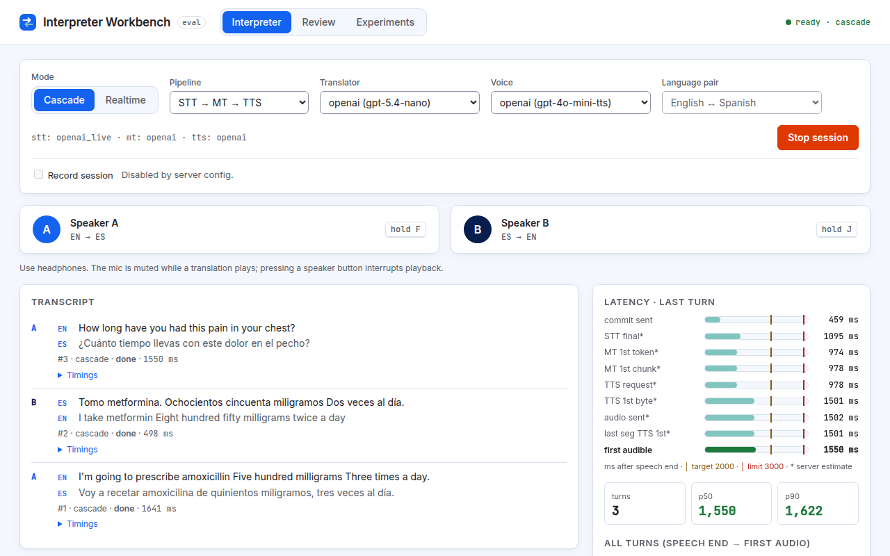

# 1. Getting started

## What the Workbench is for

The Workbench answers one question: **which way of building an AI interpreter works better for live conversations?** You can talk through both designs yourself, rate their output, and run repeatable benchmarks.

- **Realtime mode** uses one OpenAI model, `gpt-realtime`, that listens and speaks the translation directly.
- **Cascade mode** chains three steps: **speech-to-text (STT)**, which turns speech into written text; **machine translation (MT)**, which translates that text; and **text-to-speech (TTS)**, which reads the translation aloud.

Both modes are measured the same way, in your browser, so their numbers can be compared fairly.

The app has four tabs:

- **Interpreter:** hold a live conversation and watch the timings.
- **Review:** rate recorded translations blind (without knowing which setup made them).
- **Experiments:** run the standard test sentences through chosen setups and compare the results.
- **Docs:** this user guide, inside the app.

## Logging in

The hosted app is protected by one shared password.

1. Open the app's web address. Your browser shows its own sign-in box.
2. Enter the username and password you were given.
3. The app remembers you with a signed **session cookie** (a small token your browser stores), so you are not asked again on every page.

To leave, press **Logout** in the top-right corner. See [Troubleshooting](07-troubleshooting-faq.md#logout-quirks) for why your browser may still remember the password afterwards.

When the app runs locally without a password, there is no sign-in box and no Logout button.

## Use headphones

Always wear headphones. Without them, the microphone can pick up the translation coming out of your speakers and treat it as new speech. The app also mutes your microphone while a translation is playing, as a second safeguard.

## Allow the microphone

The first time you press **Start session** on the Interpreter tab, the browser asks for permission to use your microphone. Choose **Allow**.

- If you block it, a red banner explains how to fix it and offers a **Retry** button. See [The microphone is blocked](07-troubleshooting-faq.md#the-microphone-is-blocked).
- Browsers only allow the microphone on a **secure context**: a page served over HTTPS, or from `http://localhost`. The hosted app uses HTTPS.

## The screen at a glance

- **Header:** the tabs, a status label such as `ready · cascade` (session state and mode), a red **● Recording** label if the session is being recorded, and **Logout**.
- **Controls card:** mode, provider pickers, language pair, Start/Stop, and the Record toggle.
- **Speaker buttons:** Speaker A and Speaker B.
- **Transcript** on the left and **Latency** on the right.

Next: [the Interpreter tab](02-interpreter.md).
