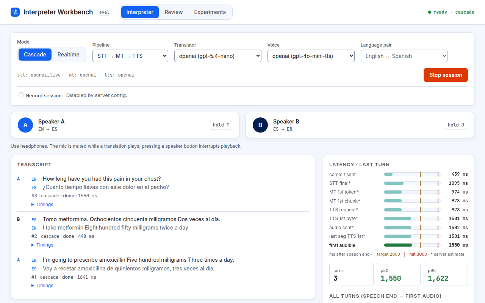
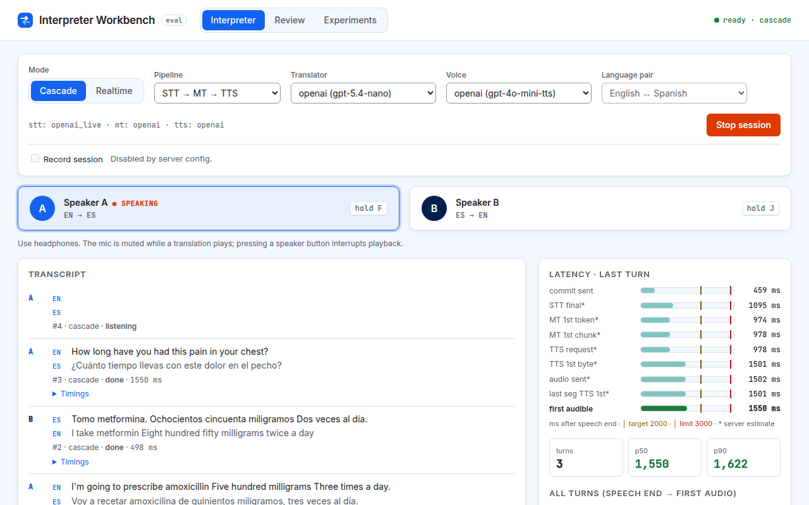

# 2. The Interpreter tab

This is where you hold a live, two-language conversation through the AI interpreter.

## Before you start

1. **Pick a language pair** in **Language pair**. English ↔ Spanish is the default and the only pair that has been benchmarked. Other configured pairs (for example English ↔ French) are labelled "(not benchmarked)": they work, but no quality claims are made for them. You can only change the pair while no session is running.
2. **Pick a mode:** **Cascade** or **Realtime** (see below).
3. Optionally tick **Record session** (see [Recording and privacy](06-recording-and-privacy.md)). It must be set before you start.
4. Press **Start session**. The status label in the header changes to `connecting`, then `ready`.

## Talking: Speaker A and Speaker B

The Workbench uses **push-to-talk (PTT)**: like a walkie-talkie, you hold a button while you speak and let go when you are done.

- **Speaker A** translates from the first language to the second (for example **EN → ES**). Hold the button, or hold the **F** key.
- **Speaker B** translates the other way (for example **ES → EN**). Hold the button, or hold the **J** key.

While you hold a button it shows **● SPEAKING**.

When you let go, the translation plays. Your microphone is muted while it plays. **Pressing a speaker button during playback interrupts it** (this is called a *barge-in*), so you can cut in, as in a real conversation.

Only one speaker can talk at a time. The F and J keys only work on the Interpreter tab while the session is `ready`.

## Cascade mode

The Cascade runs your speech through three steps on the Workbench server:

1. **STT (speech-to-text)** writes down what you said, live (`gpt-live-transcribe`).
2. **MT (machine translation)** translates the text, word by word as it is produced.
3. **TTS (text-to-speech)** reads the translation aloud, sentence by sentence.

Extra Cascade controls:

- **Pipeline:** `STT → MT → TTS` is the normal setting. `Loopback (latency floor)` just plays your own audio back without translating it. It shows the smallest delay the audio path itself adds, and costs nothing.
- **Translator:** which MT service to use, for example `openai (gpt-5.4-nano)` or Claude Haiku via OpenRouter.
- **Voice:** which TTS service to use, for example `openai (gpt-4o-mini-tts)` or ElevenLabs.

A choice marked "(unavailable: …)" is switched off on this server; the reason is shown next to it. A line under the controls (for example `stt: openai_live · mt: openai · tts: openai`) shows which providers the current session is using.

On a long turn, the Cascade starts translating and speaking your first sentence while you are still talking.

## Realtime mode

In Realtime mode your browser talks directly to OpenAI's Realtime model, which listens and speaks the translation in one step. The default model is `gpt-realtime`.

Extra Realtime control:

- **Turn taking:** **Push-to-talk** (the default) or **Auto (VAD)**. **VAD (voice activity detection)** means the model decides when you have finished by listening for a short silence, so you don't hold a button; you just speak in either language. Push-to-talk works better for long turns: in testing, Auto mode added the silence wait and broke up long monologues.

The on-screen transcript of what the speaker said comes from a separate transcription model (`gpt-4o-transcribe`), not from the interpreting model itself.

## Switching modes and language pairs

- **Mode:** you can switch between Cascade and Realtime **during** a session. The conversation history stays, and a marker in the transcript shows where you switched.
- **Language pair:** stop the session first (**Stop session**), change the pair, then start again.

## The transcript

Each turn shows the speaker (A or B), what was said (with its language code), and the translation. Under it: the turn number, the mode, the status (for example `done`) and the turn's delay in milliseconds (ms; 1,000 ms = 1 second). Click **▸ Timings** to see that turn's detailed timings.

## Reading the latency bars

The **Latency · last turn** card shows, for the most recent turn, how long each step took. **Latency** means delay. Every number is in **milliseconds after speech end**: counted from the moment you stopped talking.

Each row is a bar on the same scale. Two vertical lines mark the **target** (orange) and the **limit** (red):

| Mode | Target | Limit |
|---|---|---|
| Cascade | 2,000 ms | 3,000 ms |
| Realtime | 1,500 ms | 1,500 ms |

### What each row means

| Row | In plain words |
|---|---|
| **commit sent** | When the app told the interpreter "the speaker has finished". With push-to-talk this is roughly when you let go of the button, so it includes the short pause between your last word and the release. |
| **STT final\*** | When speech-to-text delivered its finished transcript. |
| **MT 1st token\*** | When the translation model produced its first piece of text. A **token** is a small chunk of text, often part of a word. |
| **MT 1st chunk\*** | When the first piece of translation big enough to speak (a phrase or sentence) was ready. |
| **TTS request\*** | When that first chunk was sent to text-to-speech. |
| **TTS 1st byte\*** | When the first bit of synthesised audio came back. |
| **audio sent\*** | When the server started sending that audio to your browser. |
| **last seg TTS 1st\*** | For multi-sentence turns: when audio for the last sentence began arriving. |
| **first audible** | **The headline number.** When you could first hear the translation. It turns green when within target, amber between target and limit, and red over the limit. |

**Rows marked \* are server estimates.** The server times them from when it received the "finished" signal, and the app places them after the **commit sent** mark. The **commit sent** and **first audible** rows are measured exactly, in your browser. Because the Cascade may start translating early (before you let go), a step such as **MT 1st token** can appear *earlier* than **STT final**. That is expected.

In Realtime mode there are no server rows: the model does all steps at once, so you see only **commit sent** and **first audible**.

### The summary under the bars

- **turns**, **p50** and **p90** for the current mode. **p50** is the *typical* delay: half the turns were faster. **p90** is the *slower case*: 9 in 10 turns were faster. Both use the last 50 timed turns.
- **All turns (speech end → first audio):** a table per mode with the headline delay and each server step (n = number of turns).

See [Understanding the numbers](05-understanding-the-numbers.md) for more.

## Exporting a session

**Export JSON** and **Export CSV** download every turn of the session with its texts and timings. CSV opens in a spreadsheet; JSON is for programs.
