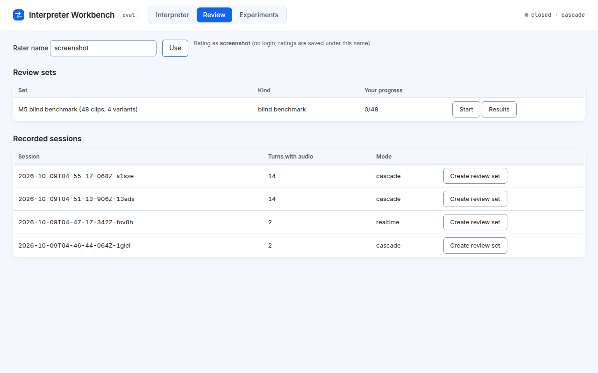

# 3. The Review tab

The Review tab collects human quality ratings. You listen to translated clips one at a time and score each from 1 to 5.

## Why ratings are blind

In the benchmark set, you are **not told which setup made each clip**, and the clips are shuffled. This stops expectations ("Realtime is probably better") from influencing your scores. The setup names (also called *variants*) are hidden by the server itself, not just on screen, until you finish every clip or choose to reveal them.

## Getting started

1. Type your name in **Rater name** and press **Use** (or Enter). There is no separate login: your ratings are saved under that name, so use the same name each time.
2. Pick a set in **Review sets**:
   - **M5 blind benchmark:** 48 clips from the final benchmark run (12 sentences × 4 setups).
   - **Recorded sessions** (below): any session that was recorded (see [Recording and privacy](06-recording-and-privacy.md)). Press **Create review set** to turn each turn's translated audio into a clip.
3. Press **Start** (or **Resume** if you have begun).

## Rating a clip

Each clip shows its **direction** (for example EN → ES), **what the speaker said**, the **reference translation** (a correct human-style translation to compare against), and an audio player. The clip plays automatically.

Score three things from **1** (poor) to **5** (excellent):

| Scale | Question |
|---|---|
| **Accuracy** | Did the meaning come through correctly? |
| **Fluency** | Natural, grammatical language? |
| **Voice** | Does the voice sound human and pleasant? |

Add **Notes** if you like, then press **Save & next →** (on the last clip, **Save & finish**). **← Back** saves and returns to the previous clip.

### Keyboard shortcuts

| Key | What it does |
|---|---|
| **1**–**5** | Score the highlighted row (marked ◀) and move to the next row |
| **Tab** / **Shift+Tab** | Move the highlight down / up |
| **Space** | Play or pause the clip |
| **Enter** | Save and go to the next clip |

Shortcuts are ignored while you type in Notes.

### Progress and saving

- The header shows "*n* of 48" and how many clips you have rated.
- When you come back, you resume at the first clip you have not fully scored.
- If a save fails, a red message says so and your scores stay on screen so you can try again.

## Seeing results

Press **Results** (in the set list, or the **Rate / Results** toggle).

- For a blind set, results stay **locked** until you have rated every clip. To see them earlier, press **Reveal variants**. Ratings you save after revealing are flagged as such, because they are no longer blind.
- Results show, per setup: the number of ratings (**n**) and for each scale the **mean / median (sd, range)**. The *mean* is the average; the *median* is the middle score; *sd* (standard deviation) shows how spread out the scores are; the *range* is lowest–highest. **Composite** is the average of the three scales.
- They are grouped **Overall** and per direction, and shown next to that setup's benchmark delay (**M5 H p50 / p90**, in ms) and **chrF** translation score. "M5" is the final benchmark run of 8 Oct 2026. See [Understanding the numbers](05-understanding-the-numbers.md).
- Switch between **My ratings** and **All raters** (pooled; the number of raters is shown).
- **Export results CSV** and **Export my ratings CSV** download the data.

The ratings of rater `andre` (all 48 clips) are preloaded.
