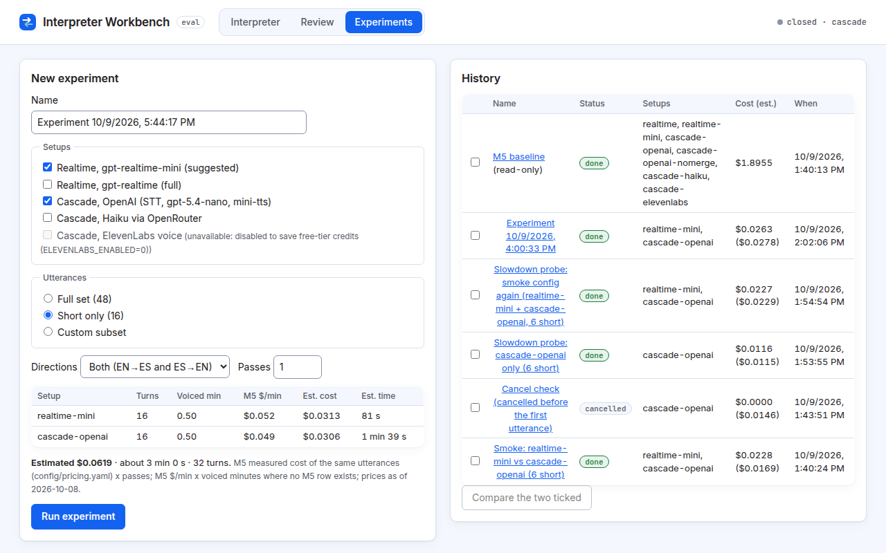

# 4. The Experiments tab

An **experiment** plays a fixed set of recorded test sentences through one or more setups, exactly like the official benchmark, and saves the results. Behind the scenes a hidden Chrome browser drives the Workbench itself, using each recording in place of a microphone.

## Setting one up

In **New experiment**:

1. **Name:** pre-filled with the date; change it to something meaningful.
2. **Setups:** tick one or more. A *setup* is one interpreter configuration:

   | Setup | What it is |
   |---|---|
   | Realtime, gpt-realtime-mini (suggested) | The smaller, cheaper Realtime model |
   | Realtime, gpt-realtime (full) | The full Realtime model |
   | Cascade, OpenAI (STT, gpt-5.4-nano, mini-tts) | The default Cascade |
   | Cascade, Haiku via OpenRouter | Cascade with Claude Haiku as the translator |
   | Cascade, ElevenLabs voice | Cascade with ElevenLabs as the voice |

   The first and third are ticked by default. Setups this server can't run are greyed out with the reason.
3. **Utterances:** which test sentences ("utterances") to use: **Full set (48)**, **Short only (16)** (the default), or **Custom subset** (tick sentence ids; hover to see the text).
4. **Directions:** both directions, or only one (for example English → Spanish only).
5. **Passes:** how many times to repeat the whole set (1–5).

Experiments use the benchmarked pair only (English ↔ Spanish), because the test sentences are in those languages.

## The cost estimate

As you change settings, an estimate table updates. For each setup it shows **Turns**, **Voiced min** (minutes of actual speech, silence excluded), **M5 $/min**, **Est. cost** and **Est. time**, plus a total.

The estimate is **not a quote**. It is based on what the same sentences actually cost in the final benchmark run (M5), priced with the dated list prices shown under the table. The real cost can differ a little; the run's actual cost is recorded afterwards and shown next to the estimate in History.

## Guardrails

- **Confirmation above $1:** if the estimate is above the confirmation threshold ($1), you must click **Run anyway** before it starts.
- **Cost warning for the full Realtime model:** ticking `gpt-realtime` (full) shows a warning that it costs about 3.4× more per minute than the mini model.
- **ElevenLabs credits:** the ElevenLabs setup needs an extra tick, "I accept spending ElevenLabs credits", and the server's credit guard still refuses runs over its session and monthly caps. It is only available when ElevenLabs is enabled on the server.
- **Small samples:** with fewer than 12 turns per setup, a warning says latency medians are unreliable; add utterances or passes.
- **One at a time:** only one experiment can run. While one is running, the button reads "Another experiment is running"; a second run is refused, not queued.

## Running and watching

Press **Run experiment**. A live panel shows the current setup, the sentence being played, turns done/total, the running typical delay (**p50 H**), failures, the cost so far and elapsed time.

**Cancel** stops the run and keeps the results gathered so far.

## Reading results

Every run appears in **History** with its status, setups, cost (with the estimate in brackets) and time. Click a name to open it. **M5 baseline** (read-only) holds the final benchmark numbers for comparison.

The detail view shows the code version, the model ids, and a table per setup:

| Column | Meaning |
|---|---|
| n / done | Turns planned / completed |
| H p50, H p90 | Delay from speech end to the first audio of the last sentence, typical and slower case (ms). **First audible** is the literal first sound (on split Cascade turns, the first sentence) |
| H−gap p50, H−gap p90 | The same with the 0.45 s button-release pause subtracted |
| tail p50 | Cascade only: the server's estimate of when audio for the turn's final sentence started (typical; excludes network and playback) |
| chrF en→es, es→en, all | Translation score per direction and overall (0–100, higher is better) |
| WER en, WER es | Speech-to-text word error rate per language (lower is better) |
| $/min, $ total | Cost per minute of speech, and in total |
| failures | Turns that did not complete |

Below it, a chart plots each turn's delay. Download **Summary CSV**, **Per-turn CSV** or **JSON**.

All terms are explained in [Understanding the numbers](05-understanding-the-numbers.md).

## Comparing two runs

Tick the boxes next to two experiments in History and press **Compare the two ticked**. A table lists each setup's metrics for run A and run B and the difference (**B − A**). Lower is better for latency, WER, $/min and failures; higher is better for chrF.
